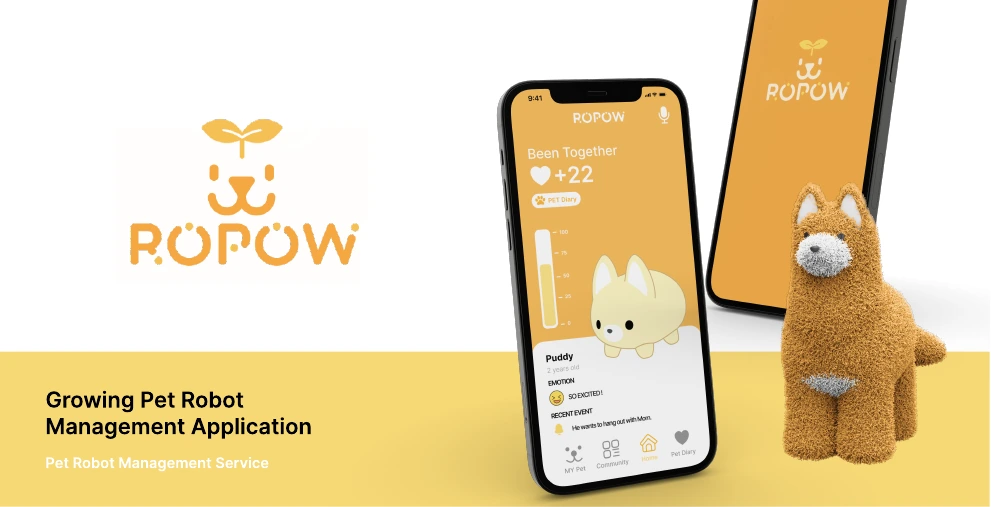
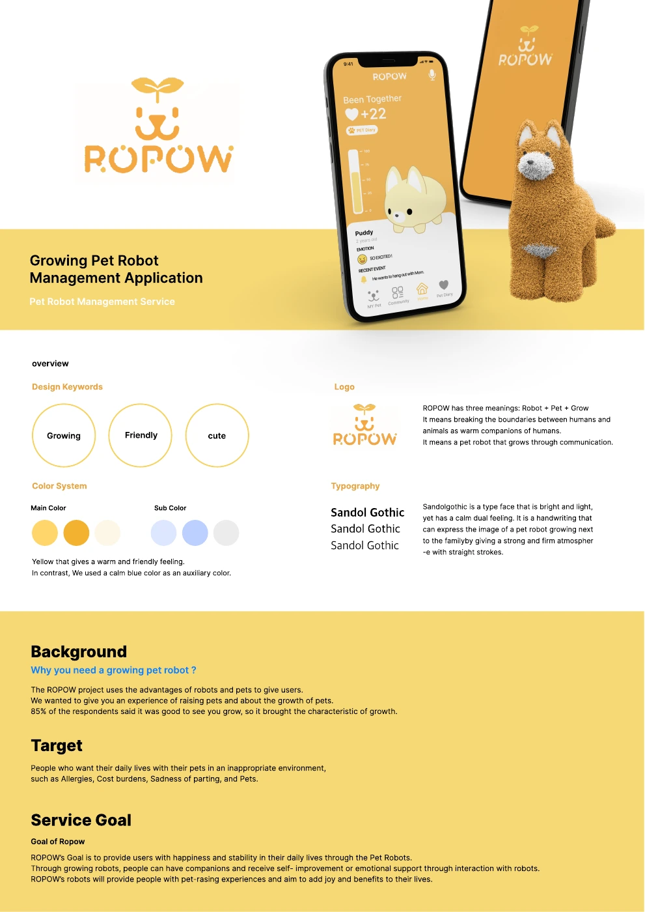
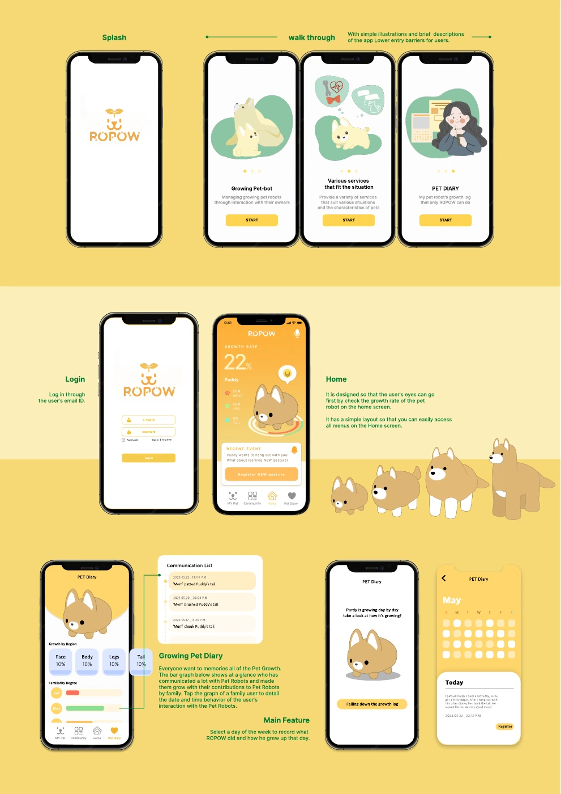
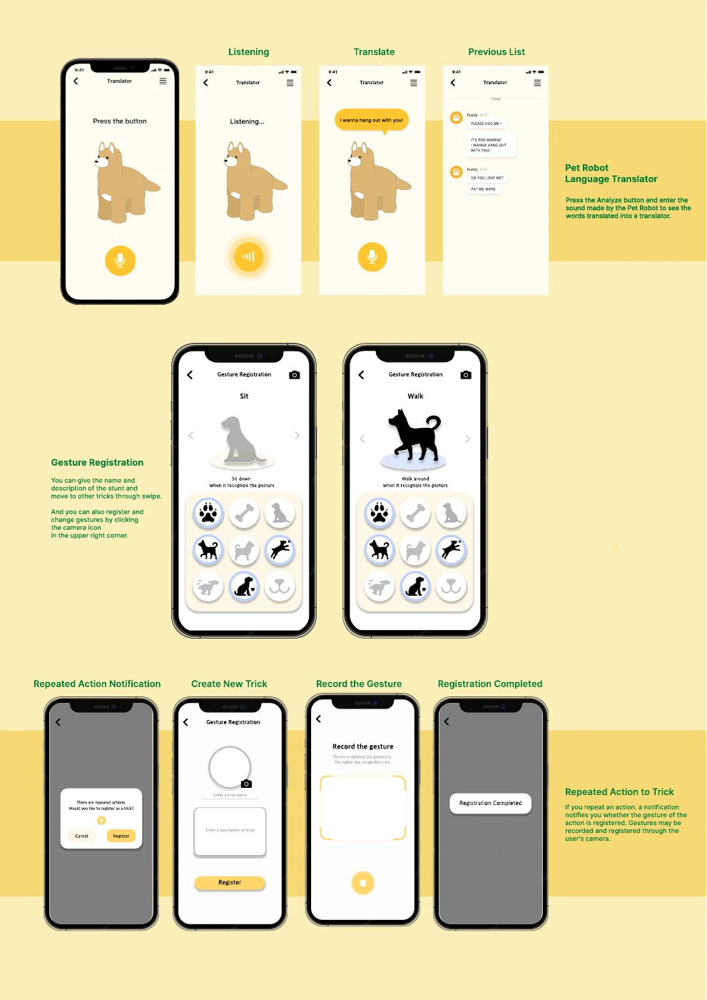
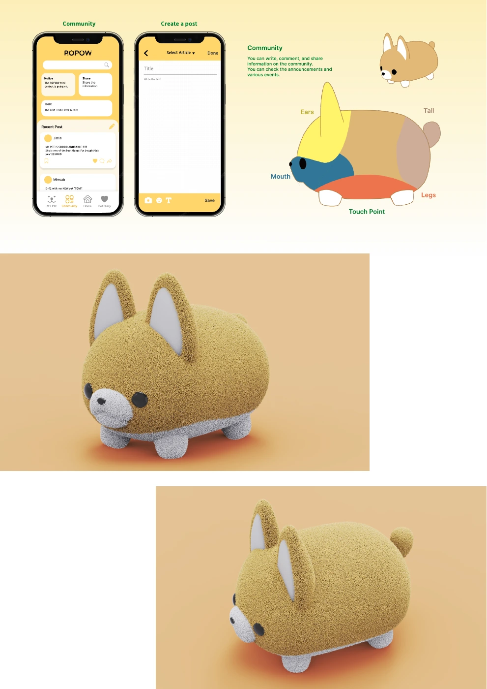
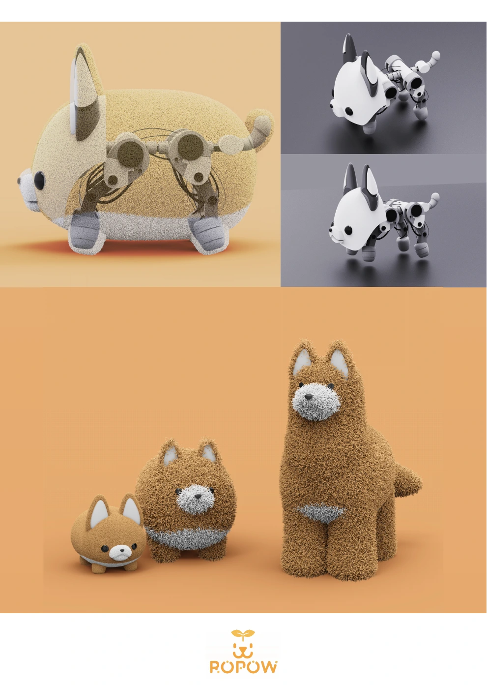

# ROPOW

**Robot + Pet + Grow · Growing Pet Robot Management Application**

2023년 1학기 UX Design 강의에서 만든 팀 프로젝트입니다. 사용자와의 상호작용을 통해 성장하는 애완로봇과, 그 일상을 기록하고 관리하는 모바일 앱의 경험을 설계했습니다.

이 저장소에는 **UX 설계 결과물**을 보관합니다. 아래의 성장·제스처 학습·소리 번역은 프로토타입 화면에 표현한 서비스 구상입니다. 작동하는 로봇, 앱 백엔드 또는 AI 인식·번역 시스템을 구현했다는 의미가 아닙니다.

## 핵심 사용자 경험

| 흐름 | 최종 설계에 표현한 내용 |
| --- | --- |
| 시작과 온보딩 | 성장하는 Pet-bot, 상황별 서비스, PET Diary 소개와 로그인 화면 |
| Home | 성장률, 부위별 상태, 최근 이벤트와 주요 메뉴 |
| Growing Pet Diary | 상호작용 기록, 가족별 친밀도, 날짜별 성장 일지 |
| 제스처 등록 | 반복 행동 알림 → 이름·설명 작성 → 동작 기록 → 등록 완료 |
| Pet Robot Language Translator | 듣기 → 분석 상태 → 번역 결과 → 이전 기록의 화면 흐름 |
| Community | 공지, 게시물 공유, 작성, 트릭 관련 콘텐츠 |
| 로봇 콘셉트 | 귀·입·다리·꼬리의 터치 포인트와 성장 단계 렌더링 |

## 디자인 결과물

Growing · Friendly · Cute를 중심으로 따뜻한 노랑과 차분한 파랑을 사용했습니다. Figma 프로토타입과 최종 그래픽 패널에 앱의 주요 흐름과 로봇 콘셉트를 정리했습니다.

보관된 최종 패널을 웹에서 보기 쉬운 이미지로 변환했습니다. 전체 패널의 내용은 유지했으며, 표지 이미지만 첫 패널의 상단 부분을 사용합니다.

### 01 · 브랜드와 서비스 배경

### 02 · 온보딩, Home, 성장 일지

### 03 · 번역과 제스처 등록의 UX

### 04 · 커뮤니티와 로봇 터치 포인트

### 05 · 로봇 구조와 성장 단계 콘셉트

## 공개 범위와 해석

- 최종 팀 결과물 중심으로 소개하며, 개인별 담당 범위를 구분하지 않습니다.
- 사용자 인터뷰 원문, 학생 식별 정보, 강의 노트와 상용 폰트 파일은 포함하지 않습니다.
- 패널의 계정·일지·커뮤니티 내용은 디자인 화면의 예시입니다.
- 당시 패널에 적힌 조사 수치는 이 공개 과정에서 표본과 조사 방법을 다시 검증하지 않았습니다. 사용자 효과나 건강·심리적 효능의 근거로 사용하지 않습니다.
- 편집 가능한 Figma 원본과 실행 가능한 앱·하드웨어 소스는 이 저장소에 없습니다.
- 폰트·일러스트·목업 등 제3자 자료에 새로운 재배포 라이선스를 부여하지 않습니다.
